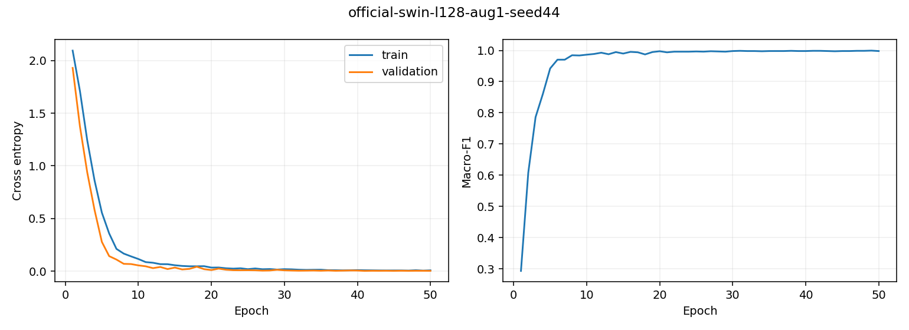
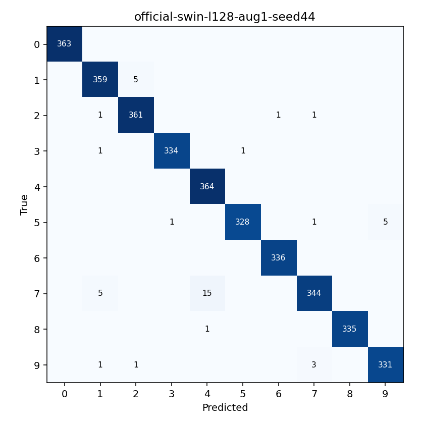
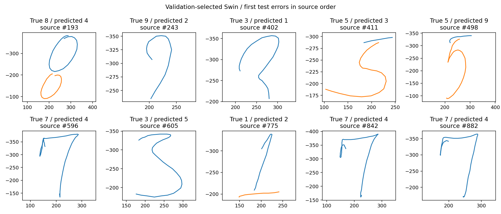

# DrawAI — Báo cáo D3

> Tài liệu lịch sử D0–D6 (11/10/2026). CNN và route cũ nếu được nhắc đến không thuộc pipeline P1 hiện hành. Xem [báo cáo P1](phase1-report.md) và [training guide hiện tại](training-guide.md).

Ngày nghiệm thu: 11/10/2026. **D3 hoàn thành thực nghiệm local CPU.** Notebook đã kiểm tra cấu trúc và thực thi CPU smoke; chưa thực chạy Kaggle GPU.

Experiment: `d3-local-v1`. Tất cả 8 pilot và 6 run chính thức hoàn thành, checkpoint chọn bằng validation trước khi mở test. Kiểm toán độc lập 20,988 dự đoán test đạt.

## Thiết kế và dữ liệu

- PenDigits gốc, hợp đồng drawai-geometry-v1, ba kênh x/y/stroke_start. Train 5.999, validation 1.495, test chính thức 3.498 mẫu.
- Validation phân tầng theo lớp seed 42; có thể chung người viết với train vì writer ID chưa xác minh. Test chính thức giữ nguyên theo D1.
- Hai họ mô hình có cùng split, metric, optimizer, ngân sách pilot/official và cách chọn checkpoint. Config L/augmentation được chọn riêng bằng validation.
- Pilot 12 epoch: CNN/Swin × L64/L128 × augmentation bật/tắt, seed 42. Official tối đa 50 epoch, patience 10, seeds 42/43/44.
- Batch 128; AdamW lr 0,001, weight decay 0,01; warm-up + cosine decay; clip norm 1,0. Augmentation chỉ train, không lật hoặc đổi nhãn.
- Pilot CPU 4 threads; official tối đa 3 run song song, mỗi run 2 threads. Torch 2.5.1+cpu; thời gian training chịu ảnh hưởng việc chạy đồng thời, không phải benchmark GPU.

[Protocol khóa trước test](experiment-protocol.md) · [Lệnh tái lập](training-guide.md)

## Sàng lọc validation

| Model | L | Augmentation | Best validation macro-F1 | Chọn |
|---|---:|---|---:|---|
| cnn | 64 | Không | 0.997322 | ✓ |
| cnn | 64 | Có | 0.997322 |  |
| cnn | 128 | Không | 0.995263 |  |
| cnn | 128 | Có | 0.996627 |  |
| swin | 64 | Không | 0.988017 |  |
| swin | 64 | Có | 0.988669 |  |
| swin | 128 | Không | 0.985861 |  |
| swin | 128 | Có | 0.990537 | ✓ |

Quy tắc hòa điểm: macro-F1 cao hơn → loss thấp hơn → L ngắn hơn → không augmentation → seed nhỏ hơn → run ID. Trong một run, checkpoint hòa macro-F1/loss giữ epoch sớm hơn.

## Sáu run chính thức

| Model | Seed | L / aug | Best epoch | Epoch chạy | Val macro-F1 | Test accuracy | Test macro-F1 | Train giây |
|---|---:|---|---:|---:|---:|---:|---:|---:|
| cnn | 42 | 64 / 0 | 35 | 45 | 0.999330 | 0.988279 | 0.988204 | 57.1 |
| cnn | 43 | 64 / 0 | 23 | 33 | 0.998633 | 0.987136 | 0.987040 | 39.7 |
| cnn | 44 | 64 / 0 | 16 | 26 | 0.997965 | 0.988851 | 0.988741 | 31.1 |
| swin | 42 | 128 / 1 | 30 | 40 | 0.997293 | 0.985134 | 0.985001 | 612.7 |
| swin | 43 | 128 / 1 | 30 | 40 | 0.998689 | 0.987421 | 0.987541 | 616.2 |
| swin | 44 | 128 / 1 | 49 | 50 | 0.999332 | 0.987707 | 0.987896 | 718.9 |

| Model | Số tham số | Accuracy mean ± sample std | Macro-F1 mean ± sample std |
|---|---:|---|---|
| cnn | 53,642 | 0.988088 ± 0.000873 | 0.987995 ± 0.000870 |
| swin | 545,038 | 0.986754 ± 0.001410 | 0.986813 ± 0.001579 |

Độ lệch chuẩn mẫu dùng ddof=1 trên ba seed; không phải confidence interval hoặc kết luận kiểm định thống kê.

## Checkpoint bàn giao D4

- Run: `official-swin-l128-aug1-seed44`; chọn bằng validation macro-F1/loss, không lấy seed có test cao nhất.
- Checkpoint: `artifacts/drawai/d3-local-v1/runs/official-swin-l128-aug1-seed44/best.pth`.
- SHA-256: `a5ccb65dd4699b6451bf03ff23b6071382c29443213263f1fbc9ef6089fcf324`.
- Test accuracy **98.77%**, macro-F1 **98.79%**.
- Mục tiêu accuracy ≥98%, macro-F1 ≥97%: **Đạt**.
- Đây là checkpoint PyTorch đã train. Artifact ONNX trang D2 vẫn trained=false; D4 mới export/kiểm tra/phát hành model browser thật.

| Chữ số | Precision | Recall | F1 | Test support |
|---|---:|---:|---:|---:|
| 0 | 1.000000 | 1.000000 | 1.000000 | 363 |
| 1 | 0.978202 | 0.986264 | 0.982216 | 364 |
| 2 | 0.983651 | 0.991758 | 0.987688 | 364 |
| 3 | 0.997015 | 0.994048 | 0.995529 | 336 |
| 4 | 0.957895 | 1.000000 | 0.978495 | 364 |
| 5 | 0.996960 | 0.979104 | 0.987952 | 335 |
| 6 | 0.997033 | 1.000000 | 0.998514 | 336 |
| 7 | 0.985673 | 0.945055 | 0.964937 | 364 |
| 8 | 1.000000 | 0.997024 | 0.998510 | 336 |
| 9 | 0.985119 | 0.985119 | 0.985119 | 336 |

## Phân tích lỗi và giới hạn

Checkpoint chọn có 43 lỗi trên 3.498 mẫu test. Những cặp nhầm nhiều nhất: 7→4: 15 mẫu; 7→1: 5 mẫu; 5→9: 5 mẫu; 1→2: 5 mẫu; 9→7: 3 mẫu.
Best checkpoint ở epoch 49; run thực hiện 50 epoch. Learning curves lưu theo từng run để kiểm tra diễn biến train/validation, không dùng test cho early stopping.
Đã đạt mục tiêu PenDigits, tiếp tục D4 với checkpoint đã khóa; chưa suy rộng thành chất lượng canvas.
Các hình lỗi là những mẫu test sai đầu tiên theo source order, không phải tập đánh giá mới. Metric trên canvas/điện thoại/người dùng thực chưa được đo; phần đó thuộc D6.
CNN baseline được báo đầy đủ kể cả khi tốt hơn Swin. Cùng epoch budget không đồng nghĩa cùng thời gian hoặc số tham số; đọc các giới hạn này khi so sánh.

## Bằng chứng và nghiệm thu

- 7 training tests: metric tính tay, augmentation, schedule/selection, dữ liệu tamper, train không đọc test, resume đúng tuyệt đối, early stopping và test gate.
- Hai smoke run đầy đủ train/validation (CNN/Swin, hai epoch); notebook hiện tại thực thi 4 code cells trong CPU smoke, không mở test.
- Checkpoint atomic, history/config/data hashes, RNG/optimizer, configuration lock, selection lock và test-access gate.
- Evaluate tái tạo validation từ checkpoint và đối chiếu best-validation logits trước khi báo test.
- Independent verification tái tính confusion matrix/accuracy/macro-F1/recall từ predictions, đối chiếu nhãn/ID/argmax/hash và mean/std.
- Notebook/source bundle có thể tái tạo để chạy Kaggle GPU; GPU/full notebook branch chưa được thực thi.

## Hình kiểm tra

