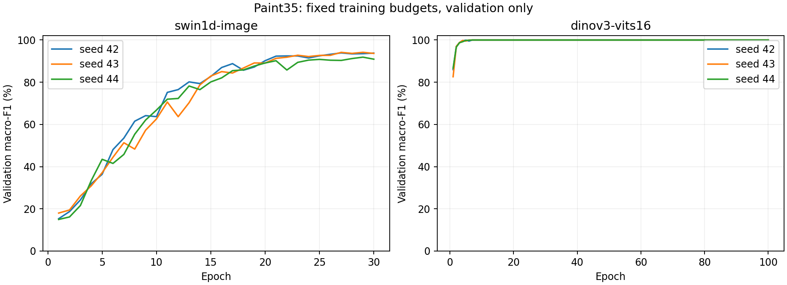
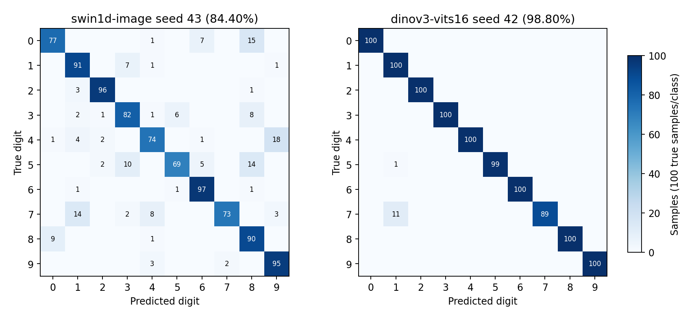

# P5 — huấn luyện và so sánh hai mô hình trên Paint35

Ngày 18/10/2026. **DONE local CPU**: sáu run thật, checkpoint đầy đủ, selection khóa bằng validation trước final test. **113 Python tests + 12 browser tests, build và audit đạt**. Giao diện/model browser cũ giữ nguyên; chưa xuất ONNX mới trong P5.

[Bằng chứng audit](../../artifacts/drawai/phase5-image64/verification.json) · [Hướng dẫn chạy](paint-training-guide.md) · [Bảng CSV](../../artifacts/drawai/phase5-image64/comparison.csv) · [Handoff P6](../../artifacts/drawai/phase5-image64/handoff.json).

## Thiết lập đã chốt trước training

Snapshot P4 `paint35-main-v1`: train4.000 / validation1.000 / test1.000; pilot/reserved1.000 nằm ngoài main. Cùng ID/nhãn/split cho hai họ, mỗi lớp train400/val100/test100. Không augmentation, không PenDigits bổ trợ. CPU4 threads, batch128, AdamW, warmup2 + cosine, clip1.0; seeds42/43/44.

Swin1D ảnh: từ đầu, chuỗi64 hàng ×64 đặc trưng cột;30 epoch tối đa/patience8, lr0.001. DINOv3 timm ViT-S/16 QKV-bias: pretrained pin SHA, backbone đóng băng, CLS+mean patches (bỏ register tokens), head Linear768→10;100 epoch tối đa/patience15, lr0.003. Đây là hai phương án khác pretraining/compute, không phải so sánh thuần kiến trúc. Plan đầy đủ: `artifacts/drawai/phase5-image64/experiment-plan.json`.

DINO trích đặc trưng development5.000 ảnh một lần: **341.27 s**; chi phí dùng chung ba seed. Thời gian DINO ở bảng dưới chỉ là tối ưu head trên cache; toàn bộ backbone vẫn nằm trong checkpoint và benchmark inference. Tổng train quan sát của Swin ba seed: **313.19 s**; DINO feature extraction + ba head: **362.08 s**. Các thời gian là wall time của phiên CPU, không phải benchmark tốc độ training thuần phần cứng.

## Kết quả sáu run

Checkpoint chọn validation macro-F1 lớn nhất, tie loss thấp nhất rồi epoch sớm hơn. Chọn seed/họ bằng validation, không đổi theo test.

| Họ | Seed | Epoch tốt nhất | Val accuracy | Val macro-F1 | Test accuracy | Test macro-F1 | Train/fit head |
|---|---|---|---|---|---|---|---|
| swin1d-image | 42 | 27 | 93.90% | 93.89% | 88.20% | 88.20% | 121.64 s |
| swin1d-image | 43 **chọn** | 29 | 94.10% | 94.17% | 84.40% | 84.28% | 95.69 s |
| swin1d-image | 44 | 29 | 91.90% | 91.88% | 87.00% | 86.96% | 95.86 s |
| dinov3-vits16 | 42 **chọn** | 98 | 100.00% | 100.00% | 98.80% | 98.80% | 6.54 s |
| dinov3-vits16 | 43 | 97 | 100.00% | 100.00% | 98.80% | 98.80% | 7.05 s |
| dinov3-vits16 | 44 | 100 | 100.00% | 100.00% | 98.80% | 98.80% | 7.23 s |

| Họ | Val macro-F1 mean ± std | Test accuracy mean ± std | Test macro-F1 mean ± std |
|---|---|---|---|
| swin1d-image | 93.32 ± 1.02 | 86.53 ± 1.59 | 86.48 ± 1.64 |
| dinov3-vits16 | 100.00 ± 0.00 | 98.80 ± 0.00 | 98.80 ± 0.00 |

Đơn vị bảng mean/std là phần trăm; std population ddof0, trên ba seed cùng split. Ba seed không phải ba bộ test độc lập hay khoảng tin cậy tổng quát hóa. DINO có std test bằng0 vì cả ba head cho cùng nhãn dự đoán; logits/checkpoints vẫn riêng từng seed.

## Selection và test cuối

Swin chọn **seed43, epoch29** bằng validation; test accuracy của checkpoint này **84,40%**. DINO chọn **seed42, epoch98**, validation macro-F1 **100%**, test accuracy **98,80%**. Candidate nghiên cứu là DINOv3; model đang chạy trên web chưa đổi. Default release còn cần export/parity/runtime và canvas-to-image validation ở P6/P7.

Selection hash: `827f063bb6fc814d94406204f2c45ac91668988c0273329a59c3f5aaeccbec51`. Test receipt gắn cùng hash; audit xác nhận thời điểm selection trước test-access trước final evaluation. Sáu model đánh giá trong một đợt cuối theo budget đã ghi; không tune lại/đổi seed sau test. Swin seed42 đạt test88,20% vẫn không thay checkpoint Swin đã chọn theo validation.

Test per-writer của hai checkpoint chọn (mỗi mã200 ảnh):

| Checkpoint | p031 | p032 | p033 | p034 | p035 |
|---|---|---|---|---|---|
| swin1d-image seed43 | 93.0% | 71.0% | 90.0% | 78.5% | 89.5% |
| dinov3-vits16 seed42 | 100.0% | 100.0% | 100.0% | 94.0% | 100.0% |

Confusion matrix/per-class/per-writer đầy đủ của từng run có trong `runs/*/summary.json` và `evaluation/final-test.json`. Metadata thiết bị không có: per-device để unavailable, không tự coi Paint là thiết bị chuột.

DINO checkpoint chọn mắc12 lỗi:11 ảnh chữ số7 dự đoán thành1 và1 ảnh chữ số5 thành1. Đây là phân tích kết quả cuối, không dùng để tuning lại.

## Kích thước, inference và bộ nhớ

| Họ | Tổng tham số | Tham số train | Checkpoint chọn | CPU p50 / p95 | Peak RSS process |
|---|---|---|---|---|---|
| swin1d-image | 548,942 | 548,942 | 2.14 MiB | 2.23 / 3.16 ms | 297.2 MiB |
| dinov3-vits16 | 21,603,850 | 7,690 | 82.49 MiB | 80.14 / 84.00 ms | 570.3 MiB |

Máy đo: AMD Ryzen7 H255,8 cores/16 logical processors; môi trường PyTorch2.5.1+cpu. Mỗi họ đo ở fresh process, CPU4 threads/batch1,10 ảnh validation phủ0–9 lặp lại,5 warmup +50 lần đo. Timing gồm preprocessing từ uint8 PNG64 đã decode và full PyTorch model; không gồm đọc đĩa, HTTP/browser hay ONNX. Peak RSS gồm import, verify dataset, load checkpoint và inference; không phải bộ nhớ riêng model/VRAM. Không so sánh trực tiếp với latency WASM/HTTP ở P2. Cold-load/timing breakdown/RSS snapshots nằm trong `benchmark-*.json`.

## Checkpoint thật bàn giao P6

Thư mục local: `artifacts/drawai/phase5-image64/runs/`; các file .pth/.npz bị Git ignore. DINO checkpoint chứa backbone+head đã fit, không chỉ head. `trained=true`, `release_ready=false`.

- `artifacts/drawai/phase5-image64/runs/swin1d-image-seed43/drawai_swin1d-image_paint35-main-v1_rows64_fp32_seed43_best.pth`
  SHA256: `3daa475f97e34c00d10380ea16157c9543de6495799ca3ee66cac642f2864619`
- `artifacts/drawai/phase5-image64/runs/dinov3-vits16-seed42/drawai_dinov3-vits16_paint35-main-v1_rgb224_fp32_seed42_best.pth`
  SHA256: `1b14dc81786010d10f4bb3c1d77c8ef3e1af44f52a2186881e616dd19906c4f3`

Tên ONNX dự kiến ở `handoff.json`, chưa có export mới. Muốn replay cần snapshot/feature cache/checkpoint local và pretrained snapshot đúng SHA; chưa tuyên bố clean checkout/Kaggle GPU đã chạy.

## Đã kiểm chứng

- 113 Python tests: factory row64 không đổi Swin nét bút cũ; optimizer/checkpoint roundtrip; resume khớp weights; cache order/hash; invalid outputs; source-output isolation; test reader cần selection.
- Audit sáu checkpoint và predictions: metrics recompute theo ID, confusion/per-class/per-writer; replay toàn bộ logits validation; checkpoint validation-best đúng histories; selection rule và receipt đúng.
- DINO backbone khớp chính xác từng tensor pretrained; kiểm tra lại10 full-backbone features từ PNG train/validation so với cache.
- 12 product browser tests và build đạt.58 file bảo vệ khớp hash; bốn ảnh desktop/mobile ở `/` và `/drawai` giống pixel P0.

## Giới hạn và bước tiếp

**37 nhóm gần giống qua split main vẫn tồn tại (34 train–test,3 train–validation).** Kết quả trên snapshot này chưa chứng minh benchmark sạch rò rỉ hoặc tổng quát hóa tới nét viết mới hoàn toàn. Không loại/đổi mẫu theo prediction. Nguồn/35 người riêng biệt/quyền dùng do chủ dữ liệu xác nhận; chưa xác minh độc lập. Metadata “Synthetic” gốc được giữ và đính chính riêng.

Split hồi cứu theo ID; mỗi validation/test chỉ5 người. DINO có pretraining quy mô lớn, Swin từ đầu; chi phí và nguồn học khác nhau. Mỗi họ chỉ thử một cấu hình trong budget đã chốt, chưa khẳng định kết quả tối ưu. NPZ gốc đã public, test isolation là quy trình. Chưa đo domain gap giữa canvas hiện tại và ảnh Paint; Swin cũ [3,128] vẫn phục vụ UI. **P6:** export full model của hai checkpoint chọn, metadata và parity. **P7:** nối canvas đúng input ảnh và kiểm chứng runtime mà giữ design.
