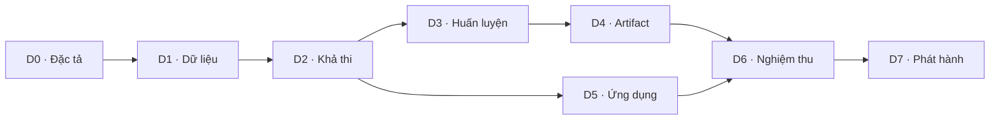

# DrawAI — Các phase triển khai chi tiết

Cập nhật: 11/10/2026. Tài liệu gốc: [kế hoạch project](../drawai-project-plan.md).

## Cách sử dụng

Mã `D0`–`D7` là phase riêng của DrawAI; các phase HAR/MotionSense không tính là tiến độ DrawAI. Thực hiện các task theo mã trong từng phase; chỉ đánh dấu hoàn thành khi có đầu ra và bằng chứng nghiệm thu. Các file được liệt kê dưới đây là đầu ra cần tạo, trừ tài liệu kế hoạch hiện có.

Trạng thái task: `[ ]` chưa hoàn thành, `[x]` đã hoàn thành. Khi chạy một phase, ghi lệnh tái lập, môi trường, kết quả và các mục chưa đạt trong báo cáo phase. Mục tiêu metric/hiệu năng chưa phải kết quả đo.

## Tổng quan và phụ thuộc

| Phase | Mục tiêu | Phụ thuộc | Trạng thái ban đầu | Ước lượng |
|---|---|---|---|---|
| D0 | Đặc tả và chuẩn bị project | Không | Hoàn thành local | 0,5 ngày |
| D1 | Dataset và tiền xử lý Python | D0 | Hoàn thành; writer ID chưa xác minh, split fallback | 1–1,5 ngày |
| D2 | Kiểm chứng mô hình và ONNX/browser | D1 | Hoàn thành local | 0,5–1 ngày |
| D3 | Huấn luyện và đánh giá | D2 | Hoàn thành local CPU; notebook CPU smoke, GPU chưa chạy | 1,5–3 ngày |
| D4 | Đóng gói artifact thật | D3 | Hoàn thành local CPU/Chromium | 0,5–1 ngày |
| D5 | Ứng dụng DrawAI | D1, D2; cần D4 để nghiệm thu đầy đủ | Hoàn thành local Chromium | 2–3 ngày |
| D6 | Nghiệm thu tích hợp và nét thực tế | D4, D5 | Kỹ thuật local đạt; chờ người/thiết bị thật | 1–1,5 ngày |
| D7 | Phát hành và bàn giao | D6 | Chưa làm | 1–1,5 ngày |

Tổng dự kiến 8–13 ngày công, chưa tính chờ GPU, người tham gia thu nét, tài khoản hosting hoặc vòng cải tiến ngoài MVP. D5 có thể bắt đầu sau D2 trong khi D3–D4 đang chạy. Báo cáo D6 cần cả D4 và D5 hoàn thành.

## D0 — Đặc tả và chuẩn bị project

**Mục tiêu:** xác định chính xác sản phẩm cần làm, các module và cách nghiệm thu.

- [x] **D0-01 — Kế hoạch tổng thể:** xác định PenDigits gốc, MVP một chữ số, CNN baseline và Swin, ONNX trên browser. Đã lưu trong `docs/drawai-project-plan.md`.
- [x] **D0-02 — Đặc tả sản phẩm:** ghi luồng vẽ → nhận dạng → xem top-3 → thử lại; danh sách chức năng, trạng thái rỗng/tải/sẵn sàng/đang xử lý/lỗi; ý nghĩa online là chuỗi nét có thứ tự. Xác định suy luận bắt đầu khi bấm nút.
- [x] **D0-03 — Khung hợp đồng dữ liệu:** định nghĩa JSON nét vẽ có `schema_version`, kích thước vùng vẽ, hệ tọa độ, `strokes`; điểm gồm x/y và timestamp tương đối khi có. Mẫu dataset không có timestamp thì ghi thiếu, không tự coi timestamp giả là dữ liệu quan sát. Chốt phần tiền xử lý còn mở ở D1.
- [x] **D0-04 — Kiến trúc module:** thống nhất các thư mục `training/drawai`, `web/src/drawai`, `artifacts/drawai`, `docs/drawai`; giao diện worker, version preprocessing và labels 0–9. Route dự kiến `/drawai`.
- [x] **D0-05 — Môi trường và tái lập:** ghi phiên bản Python/Node/PyTorch/ONNX/ORT; thiết kế dependencies riêng cho DrawAI. Ghi lỗi import ONNX DLL hiện có vào danh sách cần xử lý ở D2; không xem môi trường export là đã sẵn sàng.
- [x] **D0-06 — Ma trận nghiệm thu:** ánh xạ task → phép kiểm tra → báo cáo; phân biệt yêu cầu đúng chức năng, mục tiêu nghiên cứu và việc cần người dùng/thiết bị ngoài môi trường hiện tại.

**Đầu ra:** `docs/drawai/scope.md`, khung `data-contract.md`, `acceptance-criteria.md`, `environment.md`; cấu trúc module và dependency manifest khi cần.

Nghiệm thu D0 được rà soát lại: [báo cáo D0](d0-report.md), [kiến trúc worker](architecture.md), [schema nét](strokes.schema.json), [ví dụ schema](../../examples/drawai/README.md); report máy đọc tại `artifacts/drawai/d0/verification.json`.

**Điều kiện qua phase:** phạm vi MVP rõ ràng; đầu vào/đầu ra và nhãn được định nghĩa; mọi lựa chọn còn mở có phase giải quyết. Tạo thư mục hoặc kế hoạch chưa đồng nghĩa đã có mô hình hoạt động.

## D1 — Kiểm toán dataset và tiền xử lý Python

**Mục tiêu:** tạo dữ liệu train/validation/test đúng, có thể tái lập và giữ cấu trúc nét.

- [x] **D1-01 — Nguồn dữ liệu:** kiểm tra archive đã tải, lưu URL/tên file/SHA-256; giải nén `.Z`, lưu bản gốc và metadata nguồn. Đọc `pendigits-orig`, không dùng bản 8 điểm làm đầu vào chính.
- [x] **D1-02 — Parser UNIPEN:** đọc nhãn, thứ tự điểm, ranh giới nét và metadata thực có trong file. Tạo sample ID ổn định; gắn mỗi mẫu với file và vị trí nguồn. Mọi segment hoặc nhãn không hợp lệ phải được báo, không âm thầm bỏ.
- [x] **D1-03 — Kiểm toán:** đối chiếu số mẫu 7.494/3.498 theo tài liệu; thống kê lớp, số điểm/nét, điểm lặp, giá trị bất thường và bản ghi trùng. Kiểm tra writer ID; không suy ID từ thứ tự. Nếu phát hiện trùng giữa split, ghi nhận và nêu cách báo cáo tác động, không sửa test chính thức âm thầm.
- [x] **D1-04 — Kiểm tra trực quan:** vẽ mẫu đại diện đủ 10 lớp, đánh dấu đầu nét và hướng viết; xác minh chiều trục y và nhãn. Lưu hình chẩn đoán cùng sample ID.
- [x] **D1-05 — Chia tập:** giữ nguyên test chính thức. Nếu writer ID xác thực được, tách khoảng 24/6 người cho train/validation; nếu không, tách phân tầng theo lớp bằng seed cố định và công bố giới hạn. Lưu manifest mẫu/nhãn/writer và kiểm tra giao tập.
- [x] **D1-06 — Chuẩn hóa:** chuyển sang hệ tọa độ thống nhất, đưa tâm bounding box về gốc, chia x/y cho cùng kích thước lớn nhất để giữ tỷ lệ. Chốt chính xác miền giá trị, xử lý biên độ 0 và các bước tính toán trong hợp đồng. Mọi thống kê học từ dữ liệu, nếu dùng, chỉ được tính từ train.
- [x] **D1-07 — Resample theo nét:** thử L=64 và 128; phân bổ số điểm theo độ dài cung trong mỗi nét, giữ thứ tự/đầu/cuối, tạo `stroke_start`. Chốt quy tắc nét một điểm, điểm lặp, nét quá ngắn và số nét vượt ngân sách; không tạo đoạn nối giữa hai nét hoặc âm thầm cắt nét.
- [x] **D1-08 — Xuất và kiểm tra:** xuất tensor float32 `[N,3,L]`, nhãn, split manifest, preprocessing version và fixture. Chạy lại phải tái tạo cùng split và nội dung tensor; test các ca biên và kiểm tra bằng kết quả tính tay cho hình học đơn giản.

**Đầu ra:** `training/drawai/prepare_data.py`, `preprocessing.py`, `training/tests/test_drawai_data.py`, `data/processed/pendigits-drawai-v1/`, `docs/drawai/data-contract.md`, `data-report.md`, `artifacts/drawai/data/`.

Đợt thực hiện D1 đã dựng lại L64/L128, đạt 17 unit tests và đối chiếu 21.984 tensor với nguồn giải nén; kiểm tra archive, manifest provenance, metadata, fixture và split độc lập. Bằng chứng: [báo cáo D1](data-report.md), `artifacts/drawai/data/verification.json`, `artifacts/drawai/data/d1-review.json`.

**Điều kiện qua phase:** không còn sai lệch số mẫu/nhãn chưa giải thích; test giữ nguyên; split tái lập; tensor hữu hạn đúng shape; tiền xử lý không mất ranh giới nét. Nếu nguồn không hỗ trợ stroke marker như dự kiến, sửa hợp đồng và cấu hình có version trước D2.

## D2 — Kiểm chứng Swin 1D và khả năng chạy trên web

**Mục tiêu:** chứng minh pipeline mô hình chạy được trước khi tiêu tốn thời gian huấn luyện.

- [x] **D2-01 — Sửa môi trường:** xác định nguyên nhân lỗi DLL ONNX; dùng môi trường DrawAI riêng nếu cần. Xác nhận import PyTorch, ONNX, ONNX Runtime và lưu phiên bản thực chạy.
- [x] **D2-02 — Model factory:** gọi backbone `SwinTransformer_1D` từ repo, cấu hình ứng viên `in_chans=3`, `num_classes=10`, L=64, patch=2, window=8, embed=32, depths=[2,2,2], heads=[2,4,8]. Kiểm tra cả L=128 và sự tương thích patch/window/merge.
- [x] **D2-03 — Forward/backward:** kiểm tra batch 1 và batch nhiều mẫu; 10 logits hữu hạn, loss hữu hạn, gradient có ở patch embedding và attention. Xem cơ chế khởi tạo để không kết luận sai về gradient bằng 0; kiểm tra sau các bước optimizer khi cần.
- [x] **D2-04 — Học tập con nhỏ:** xác nhận mô hình có thể giảm loss và học một tập con train nhỏ. Đây là kiểm tra pipeline, không báo như độ chính xác test.
- [x] **D2-05 — Export thử:** xuất ONNX float32 fixed shape `[1,3,L]`; chạy checker và ORT CPU. Fixture gồm mẫu tổng hợp và mẫu train; ghi `trained=false` cho artifact kỹ thuật.
- [x] **D2-06 — Browser WASM:** tải model thử bằng ONNX Runtime Web trong worker; kiểm tra logits khớp PyTorch với ngưỡng dự kiến `atol=1e-5`, `rtol=1e-4`; thử tải lỗi/retry và lưu report.
- [x] **D2-07 — Benchmark sơ bộ:** đo dung lượng, load/init, warm-up và inference; ghi browser/máy. Nếu quá lớn/chậm, thu gọn cấu hình dựa vào benchmark trước D3.

**Đầu ra:** `training/drawai/models.py`, `configs/swin.json`, `verify_feasibility.py`, `training/tests/test_drawai_model.py`, artifact thử riêng trong `artifacts/drawai/feasibility/`, `docs/drawai/feasibility-report.md`.

Nghiệm thu lại sau D1: 4 model unit tests, forward/backward/tiny train/export CPU, 6 browser tests và build đạt; 20 fixture + 14 input lỗi cho mỗi L64/L128. [Báo cáo D2](feasibility-report.md) và `artifacts/drawai/feasibility/d2-review.json` ghi kết quả, cấu hình và hash bằng chứng.

**Điều kiện qua phase:** forward/backward và học tập con hoạt động; export thành công; browser thực chạy được và parity đạt. Model kỹ thuật chưa được dùng để hiển thị nhận dạng cho người dùng.

## D3 — Huấn luyện và đánh giá nghiên cứu

**Mục tiêu:** có mô hình thật, baseline công bằng và kết quả có bằng chứng.

- [x] **D3-01 — CNN baseline:** xây CNN 1D nhỏ cho cùng `[N,3,L]` và 10 nhãn; ghi số tham số, dùng cùng split/tiền xử lý/metric.
- [x] **D3-02 — Training loop:** seed, batch loader, loss, optimizer, scheduler, early stopping, gradient clipping, checkpoint tốt nhất và resume. Log epoch/train loss/validation loss/accuracy/macro-F1; lưu config, hash dữ liệu và preprocessing version.
- [x] **D3-03 — Kaggle notebook:** tạo notebook chạy từ đầu với kiểm tra GPU, đường dẫn input, dependencies và export output. Smoke run ít epoch phải hoàn thành trước run dài; có lệnh tương đương để kiểm tra CPU cục bộ.
- [x] **D3-04 — Sàng lọc cấu hình:** dùng validation để so L=64/128 và augmentation nhẹ. Ngân sách tìm cấu hình được ghi cho cả CNN và Swin; tránh xoay/lật làm đổi nhãn. Không dùng test để chọn cấu hình.
- [x] **D3-05 — Run chính thức:** khóa cấu hình mỗi họ mô hình rồi chạy seeds 42/43/44 cho CNN và Swin, tối thiểu 6 run chính thức ngoài các pilot. Mỗi run lưu best checkpoint, log, config và tình trạng kết thúc; run hỏng không được tính là hoàn thành.
- [x] **D3-06 — Khóa lựa chọn:** chọn checkpoint phát hành trong họ Swin bằng validation macro-F1; quy tắc hòa điểm được ghi trước khi xem test. Lưu file quyết định gồm run ID và checkpoint hash.
- [x] **D3-07 — Test cuối:** đánh giá các run đã khóa trên test chính thức; accuracy, macro-F1, recall từng lớp, confusion matrix, mean/std giữa seed và lỗi đại diện. Báo CNN và Swin kể cả khi Swin kém hơn.
- [x] **D3-08 — Quyết định chất lượng:** so mục tiêu accuracy ≥98%, macro-F1 ≥97%. Nếu chưa đạt, ghi phân tích và lựa chọn phát hành demo nghiên cứu có giới hạn hoặc vòng nghiên cứu mới; không chỉnh mô hình theo test rồi gọi lại đó là test chưa xem.

**Đầu ra:** `training/drawai/train.py`, `evaluate.py`, configs CNN/Swin, `notebooks/kaggle_train_drawai.ipynb`, `artifacts/drawai/d3-local-v1/runs/`, `artifacts/drawai/d3-local-v1/evaluation/`, `docs/drawai/experiment-report.md`.

Nghiệm thu D3 local CPU: 8 pilot và 6 official run hoàn thành; 7 tests, notebook CPU smoke và kiểm toán 20.988 dự đoán đạt. Swin L128/augmentation/seed44 chọn bằng validation đạt test accuracy 98,77%, macro-F1 98,79%. [Báo cáo D3](experiment-report.md), [protocol](experiment-protocol.md), [lệnh tái lập](training-guide.md) và `artifacts/drawai/d3-local-v1/d3-review.json` lưu bằng chứng. D3-03 đạt notebook/CPU smoke; chưa thực chạy nhánh full trên Kaggle GPU.

**Điều kiện qua phase:** 6 run chính thức có artifact tái lập, checkpoint phát hành chọn bằng validation, metric test có nguồn đối chiếu. Các ngưỡng chất lượng là mục tiêu nghiên cứu; chưa đạt phải ghi rõ, không thay bằng metric của HAR.

## D4 — Export và đóng gói mô hình phát hành

**Mục tiêu:** tạo một bộ artifact đã train, đồng bộ và có thể kiểm tra độc lập.

- [x] **D4-01 — Xác minh checkpoint:** khớp run đã chọn, checkpoint hash, số kênh, chiều dài, nhãn và preprocessing version; load strict.
- [x] **D4-02 — Export ONNX:** float32, fixed shape `[1,3,L]` → `[1,10]`; lưu opset/input/output names và kiểm tra graph. Chưa quantize trong bản đầu.
- [x] **D4-03 — Full-test parity:** so logits/argmax giữa PyTorch và ONNX trên toàn test. Báo sai số lớn nhất, số argmax khác, metric hai runtime; mục tiêu giảm macro-F1 ≤0,001 tuyệt đối.
- [x] **D4-04 — Manifest:** tạo `model.onnx`, `preprocessing.json`, `labels.json`, `report.json`, `release.json` với version/hash/bytes, input/output shape và `trained=true`. Client từ chối artifact sai hợp đồng hoặc thiếu file.
- [x] **D4-05 — Fixture browser:** chọn cố định mẫu nhiều lớp và ca hình học; kiểm tra model đã train trên WASM. Không chỉ dùng model thử ở D2 làm bằng chứng cho bản thật.
- [x] **D4-06 — Mẫu demo:** chọn mẫu train đầu tiên hợp lệ theo ID ở mỗi lớp, có provenance/nhãn/split; không chọn theo dự đoán đúng. Lưu nét gốc cho canvas và đánh dấu rõ nguồn train.
- [x] **D4-07 — Model card:** dữ liệu/split, cấu hình, seed, checkpoint, metric, giới hạn người viết/thiết bị và cách tái tạo.

**Đầu ra:** `training/drawai/export_onnx.py`, `web/public/models/drawai-swin-v1/`, `web/public/samples/drawai/`, `artifacts/drawai/export/`, `docs/drawai/model-card.md`.

Nghiệm thu D4: ONNX 2,27 MiB trained=true; full-test parity 3.498 mẫu có 0 argmax khác, giảm macro-F1 bằng 0; 20 fixture WASM, 14 input lỗi, 13 browser tests và build đạt. Kiểm toán schema/nguồn/geometry của 10 demo train đạt. [Báo cáo D4](artifact-report.md), [model card](model-card.md) và `artifacts/drawai/export/d4-review.json` lưu bằng chứng. Trang `/drawai/release-check` kiểm tra trained release; canvas sản phẩm vẫn thuộc D5.

**Điều kiện qua phase:** model thật chạy trên Python và browser; manifest đồng bộ; parity/metric được báo; mẫu có nguồn rõ; model card phân biệt mục tiêu và kết quả đã đo.

## D5 — Xây dựng ứng dụng DrawAI

**Mục tiêu:** người dùng vẽ, sửa nét và nhận dự đoán thật qua một luồng rõ ràng.

- [x] **D5-01 — Trang và trạng thái:** route `/drawai`, bố cục vùng vẽ/kết quả/hướng dẫn; định nghĩa empty/loading/ready/drawing/predicting/result/error. Nút Nhận dạng bị vô hiệu khi input không hợp lệ hoặc model chưa sẵn sàng.
- [x] **D5-02 — Canvas:** Pointer Events, pointer capture, hỗ trợ chuột/cảm ứng/bút, quản lý stroke; xử lý pointer cancel/leave, chỉ nhận pointer đang hoạt động để tránh trộn nhiều ngón tay. Quy đổi CSS pixel/canvas pixel/DPR chính xác và giữ dữ liệu khi resize.
- [x] **D5-03 — Công cụ nét:** xóa toàn bộ, hoàn tác nét cuối, nạp mẫu. Vẽ mới hoặc sửa nét phải xóa/đánh dấu kết quả cũ ngay. Không chặn cuộn toàn trang ngoài vùng vẽ.
- [x] **D5-04 — Tiền xử lý TypeScript:** chuyển đúng hợp đồng D1; dùng cùng fixture với Python; kiểm tra lỗi đầu vào, bounding box, resample và stroke marker. Gắn version cho thuật toán.
- [x] **D5-05 — Worker và model loader:** lazy-load release thật, kiểm tra hash/shape/version, một session tái sử dụng; message có request ID và drawing revision. Bỏ kết quả quá hạn sau thao tác nét; xử lý lỗi và retry có dọn session/worker khi cần.
- [x] **D5-06 — Kết quả:** chữ số lớn, top-3 điểm softmax, thời gian inference; sắp xếp đúng nhãn; ghi điểm dự đoán thay vì độ chính xác bảo đảm. Canvas trống không tạo dự đoán.
- [x] **D5-07 — Mẫu và xuất JSON:** 10 mẫu có nhãn tham chiếu, nguồn/split; mẫu vẫn qua cùng preprocessing/model. Xuất nét với schema version; nhãn người viết cung cấp và nhãn model dự đoán phải là hai trường riêng.
- [x] **D5-08 — Responsive và tiếp cận:** kiểm tra desktop/mobile, contrast/focus/label; nút và mẫu dùng được bằng bàn phím; kết quả có live announcement; hướng dẫn vẽ rõ ràng.

**Đầu ra dự kiến:** `web/src/drawai/drawai-app.tsx`, `drawing-canvas.tsx`, `preprocessing.ts`, `inference-worker.ts`, `inference-client.ts`, `types.ts`, `drawai.css`, tích hợp route và `web/tests/drawai.spec.ts`.

Nghiệm thu D5: UI `/drawai` dùng model D4 thật; canvas, thao tác nét, demo, export JSON và worker/session tái sử dụng hoạt động. Build + 9 browser tests đạt; 10 demo logits/argmax khớp D4, softmax và schema được kiểm toán độc lập. Resize/DPR2, pointer cạnh tranh/cancel, stale result, retry, hash/contract/timestamp lỗi có bằng chứng. [Báo cáo D5](ui-report.md) và `artifacts/drawai/ui/d5-review.json`; viewport mobile không thay cho thiết bị thật hoặc dữ liệu nét người tham gia D6.

**Điều kiện qua phase:** vẽ/nạp mẫu → suy luận thật → kết quả hoạt động; clear/undo không còn kết quả cũ; model lỗi có retry; không có dự đoán giả. D5 có thể dựng UI sớm nhưng chỉ nghiệm thu đầy đủ sau D4.

## D6 — Kiểm thử tích hợp và đánh giá nét thực tế

**Mục tiêu:** xác nhận toàn hệ thống đúng và mô tả trung thực chất lượng trên cách nhập thực tế.

- [x] **D6-01 — Parity end-to-end:** cùng JSON nét → Python/TypeScript tensor → PyTorch/ONNX/browser logits; fixture một/nhiều nét, dọc/ngang, điểm trùng, mẫu ngắn và input lỗi.
- [x] **D6-02 — Luồng và race:** test nhận dạng rồi vẽ/xóa/undo/nạp mẫu ngay; xác nhận response cũ không xuất hiện. Test nhấn nhanh, pointer cancel, resize và mẫu nhiều nét.
- [x] **D6-03 — Tải artifact:** mạng chậm/lỗi, model thiếu/sai hash/sai version, retry, cache cũ; kiểm tra model/WASM tải đúng và nét người dùng không bị gửi lên mạng.
- [x] **D6-04 — Hiệu năng:** 5 warm-up + ít nhất 100 inference; model ≤10 MiB, p95 inference mục tiêu ≤100 ms trên laptop tham chiếu. Báo load/init/preprocess/inference riêng; không lấy latency laptop thay cho điện thoại.
- [ ] **D6-05 — Browser/thiết bị:** Chrome và Edge desktop, viewport 390×844/1366×768; thử cảm ứng trên thiết bị thật khi có. Ghi rõ phiên bản và mục chưa kiểm chứng, phân biệt giả lập viewport với thử điện thoại thật.
- [ ] **D6-06 — Thu nét canvas:** mục tiêu ít nhất 5 người × 10 chữ số × 5 lần = 250 mẫu; người tham gia đồng ý, dùng ID ẩn danh và lưu thiết bị nhập/nhãn người viết. Thống nhất giao thức trước khi thu. Không dùng nét do chương trình sinh thay cho bằng chứng người thật.
- [ ] **D6-07 — Đánh giá canvas:** báo accuracy/macro-F1/lỗi theo lớp và thiết bị với số mẫu hỗ trợ. Nếu fine-tune bằng một phần dữ liệu này, chia phần phát triển và đánh giá độc lập theo người trước; quay lại D3–D4 với release version mới.
- [x] **D6-08 — Nghiệm thu:** tổng hợp PASS/FAIL/NOT RUN kèm bằng chứng; sửa lỗi pipeline/UI bắt buộc, ghi các mục tiêu chưa đạt và các kiểm tra còn phụ thuộc người/thiết bị.

**Đầu ra:** Python/browser test, `artifacts/drawai/verification/`, `artifacts/drawai/benchmark/`, tập canvas và manifest khi thu được, `docs/drawai/acceptance-report.md`.

Đợt D6 local: 34 tests chạy bằng Chrome/Edge cài thực, 17 JSON end-to-end và 7 input lỗi mỗi browser; benchmark 5 warm-up + 100 inference đạt p95 3,90/3,60 ms, ONNX 2,27 MiB. 4 tests kiểm tra gate thu/evaluate canvas đạt. D6-05 đã đạt desktop/viewport/DPR, còn cảm ứng/bút thật. D6-06/07 chưa chạy: 0 mẫu người tham gia; [protocol](canvas-protocol.md), template và CLI đã chuẩn bị. D6-08 có [báo cáo](acceptance-report.md) PASS/NOT RUN nhưng phase_complete=false; không dùng fixture làm bằng chứng người thật.

**Điều kiện qua phase:** mọi kiểm tra chức năng/parity bắt buộc đạt; metric và hiệu năng có số đo. Chỉ gọi nghiệm thu thực tế đầy đủ khi đã thu và đánh giá nét người thật. Nếu thiếu người/thiết bị, phần này ở trạng thái chờ; có thể chuẩn bị D7 nhưng không ghi D6 hoàn thành toàn bộ hoặc tuyên bố chất lượng thực tế đã xác nhận.

## D7 — Phát hành và bàn giao

**Mục tiêu:** có bản chạy được trên hosting cùng hướng dẫn và bằng chứng tái lập.

- [ ] **D7-01 — Build release:** production build thành công, kiểm tra route `/drawai`, đường dẫn asset/WASM và version model; chốt commit/artifact cho lần phát hành.
- [ ] **D7-02 — Hosting:** xác minh project hosting, quyền truy cập và cấu hình hiện có; chọn target cho DrawAI, kiểm tra quota thực tế. Cấu hình MIME/cache phù hợp cho model/WASM và không giữ manifest cũ khi đổi release.
- [ ] **D7-03 — Deploy:** xuất bản bản đã kiểm chứng; kiểm tra bằng phiên browser mới tại URL thật, gồm deep link `/drawai`, tải model, nhận dạng và retry.
- [ ] **D7-04 — Hướng dẫn người dùng:** cách vẽ một chữ số, thử mẫu, xóa/undo, đọc top-3, xuất JSON và giới hạn chất lượng.
- [ ] **D7-05 — Hướng dẫn tái lập:** chuẩn bị dataset, chạy test, train/Kaggle, đánh giá, export, chạy web và build/deploy; các lệnh phải khớp script thực đã tạo.
- [ ] **D7-06 — Báo cáo đề tài:** bài toán, dataset, preprocessing, Swin 1D, baseline, thiết kế thực nghiệm, kết quả, giới hạn và hướng phát triển. Tách PenDigits test, canvas test và demo train.
- [ ] **D7-07 — Rollback/bàn giao:** ghi cách quay về release trước, manifest/hash cần giữ, URL phát hành và các hạn chế còn lại; cập nhật trạng thái phase theo bằng chứng.

**Đầu ra:** URL ứng dụng, `docs/drawai/user-guide.md`, `reproduction.md`, `release-report.md`, README cập nhật, báo cáo đề tài và model card cuối.

**Điều kiện hoàn thành project:** người dùng vào URL thật, vẽ và nhận dự đoán bằng mô hình đã train; có báo cáo đúng với kiểm chứng đã chạy, hướng dẫn tái lập và artifact truy nguyên được. Nếu phát hành sớm dạng demo khi thiếu kiểm chứng canvas/thiết bị, ghi rõ phạm vi phát hành và giữ các task còn thiếu ở trạng thái chưa hoàn thành.

## Thứ tự thực hiện ngay

D0–D5 đã đạt local theo [tiến độ và bằng chứng](status.md). Tiếp theo:

1. D6: kiểm chứng parity toàn tuyến, lỗi/race/reset/timeout và network.
2. Đo hiệu năng, thử Edge/thiết bị thật; thu và đánh giá nét người dùng theo protocol.
3. D7 phát hành sau nghiệm thu; các mục phụ thuộc người/thiết bị chưa chạy phải được ghi rõ.
4. Giữ nguyên kết quả D3; Kaggle GPU là lượt thực thi riêng còn chưa chạy.

Các phần mở rộng như dự đoán khi đang viết, nhận dạng nhiều chữ số, quantization hoặc fine-tune từ dữ liệu canvas sẽ có backlog riêng sau MVP, tránh làm thay đổi tiêu chí giữa một phase đang chạy.
