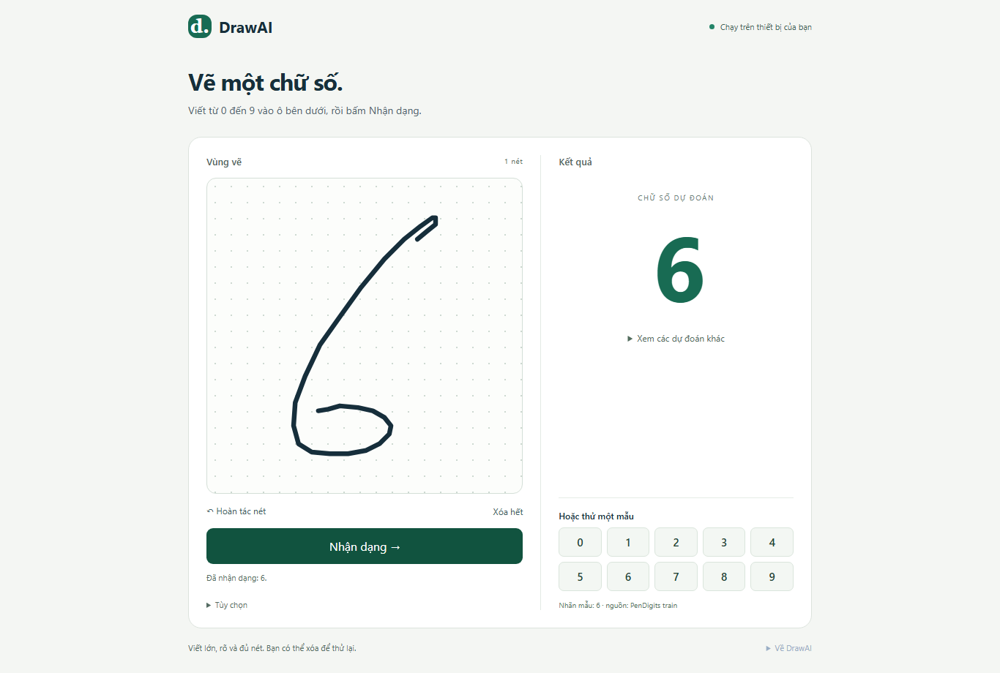
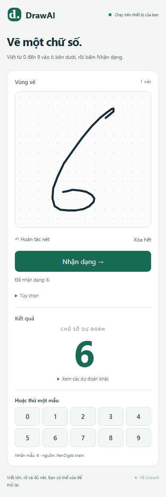

# DrawAI — Báo cáo D5

> Tài liệu lịch sử D0–D6 (11/10/2026). CNN và route cũ nếu được nhắc đến không thuộc pipeline P1 hiện hành. Xem [báo cáo P1](phase1-report.md) và [training guide hiện tại](training-guide.md).

Nghiệm thu ngày 11/10/2026: **D5-01–D5-08 đạt local Chromium**. Route `/drawai` nhận dạng thật bằng release Swin `drawai-swin-v1`; trang mặc định MotionSense và hai trang kiểm chứng DrawAI giữ route riêng. Chưa deploy; chưa nghiệm thu nét người dùng/điện thoại thật.

## Luồng đã triển khai

Canvas Pointer Events, pointer capture, chỉ một pointer chính và chuột trái; nhiều nét, undo, clear, sample và xuất JSON. Pointer cancel/lost capture bỏ nét đang viết dở; nét đã hoàn tất vẫn giữ. Giới hạn 16 nét/8.192 điểm theo hợp đồng. Nét rỗng hoặc chỉ chấm không bật Nhận dạng.

Canvas dùng viewport dữ liệu gốc 400×400, x phải/y xuống. Pointer CSS pixel quy đổi vào viewport này; resize chỉ đổi render, không sửa nét. Render buffer có DPR, vùng hiển thị vuông để giữ tỷ lệ; page scroll được ngoài canvas, touch-action:none chỉ ở canvas. DPR 2 và resize có bằng chứng tự động; không gọi đây là thử thiết bị cảm ứng thật.

Vẽ/nạp mẫu → bấm Nhận dạng → tải/kiểm tra model lần đầu → preprocessing trong worker → WASM → chữ số/top-3/latency. Lần đầu có trạng thái tải rõ ràng; button disabled khi input không hợp lệ, đang vẽ/nạp mẫu hoặc có request chạy. Xóa/undo/nạp mẫu vẫn dùng được trong lúc nhận dạng; mọi thay đổi nét xóa kết quả và tăng revision.

Worker mới dành cho sản phẩm, protocol drawai-worker-v1. Request ID/revision/version được kiểm tra, snapshot structured-clone, BUSY gate và một terminal response. Session được giữ cho request tiếp theo; mẫu/nét tự vẽ cùng preprocessing L128. UI bỏ response cũ khi revision thay đổi. Worker crash/message error/timeout 60 giây reset worker; lỗi giữ nét và có nút thử lại. Timeout là chính sách UI, chưa nghiệm thu tình huống stall/crash ở D6.

Loader từ chối trained=false/version sai, thiếu artifact, hash/bytes sai, nhãn không đúng 0–9, preprocessing/shape/input-output/provenance sai. Model chỉ tải khi bấm Nhận dạng. SHA-256 xác minh file nhất quán, không phải chữ ký.

## Kết quả và JSON

Softmax ổn định từ 10 logits; top-3 giảm dần, hòa điểm ID nhỏ hơn. UI ghi đây là điểm model, không phải độ chính xác bảo đảm. Đo preprocessing và session.run riêng; total lần đầu có thể gồm tải/init. Không dùng latency một lần click làm benchmark D6.

10 mẫu D4 được kiểm tra hash và nguồn train, fit đồng đều vào vùng 400×400 rồi đi qua pipeline thật. Nhãn mẫu hiển thị riêng với dự đoán. Nét tự vẽ/xuất JSON theo drawai-strokes-v1; tùy chọn nhãn người viết độc lập model, không xuất predicted_id thành reference_label. Không gán timestamp giả; mẫu và canvas v1 không ghi timestamp. Validator worker vẫn kiểm tra hợp đồng khi đầu vào có t: tất cả điểm có/không có, hữu hạn, không âm và không giảm giữa các nét.

## Kiểm chứng

Build TypeScript/Vite và **9 Playwright tests đạt**:

1. Cả 10 demo khớp logits/argmax D4, softmax/top-3 hợp lệ; chỉ một worker/một lần tải model cho 10 request.
2. Canvas synthetic Pointer Events → inference thật; nét mới bỏ kết quả; undo/clear và export nhãn người viết độc lập.
3. Xóa khi model tải bị trì hoãn: result cũ bị bỏ, request mới hoạt động.
4. Model 404 giữ nét; retry tạo worker mới và nhận dạng thật.
5. Hash sai không sinh kết quả.
6. Một tap không nhận dạng; pointer cancel bỏ nét dở.
7. Keyboard nạp mẫu; desktop 1366×768/mobile 390×844 không overflow; resize giữ nguyên JSON.
8. DPR 2 và pointer cạnh tranh không trộn nét hoặc nhân tọa độ dữ liệu với DPR.
9. Worker từ chối unknown fields/source null/timestamp thiếu hoặc giảm; preprocessing sai dù hash cập nhật vẫn bị từ chối.

Trong luồng 10 demo chỉ có GET static assets cùng origin; không gửi nét bằng POST/API. Đây là kiểm tra mạng của luồng đã chạy; D6 sẽ kiểm tra thêm các tình huống toàn tuyến. Verifier độc lập tính lại softmax, so logits với fixture D4, xác minh schema JSON, revision và hash source/evidence.

## UI và phạm vi kiểm tra

Hai cột desktop, một cột mobile; canvas, top-3, công cụ và mẫu có nhãn rõ. Buttons/select có focus-visible; mẫu và thao tác chạy bằng bàn phím; thông báo status live, lỗi role=alert. Canvas có tên accessible; người dùng bàn phím có thể chọn mẫu thay thao tác vẽ. Đã rà soát screenshot desktop/mobile, không dùng viewport giả lập thay chứng nhận điện thoại thật.




## Tái lập và phần tiếp theo

```powershell
Set-Location web
npm run build
npx playwright test --config playwright.drawai-app.config.ts
Set-Location ..
./.venv-phase1/Scripts/python.exe -m training.drawai.verify_ui
```

Verifier dùng dependencies training và requirements-verification.txt. Preview đang dùng port 4183; tests dùng 4186. Artifact tại artifacts/drawai/ui/; [model card](model-card.md) và [D4](artifact-report.md) là nguồn metric dataset. D6 còn cần full end-to-end fixtures, race/reset/timeout sâu hơn, Edge/thiết bị thật, benchmark và thu/đánh giá nét người thật. Không coi chữ số được vẽ tự động trong test là dữ liệu người tham gia.
