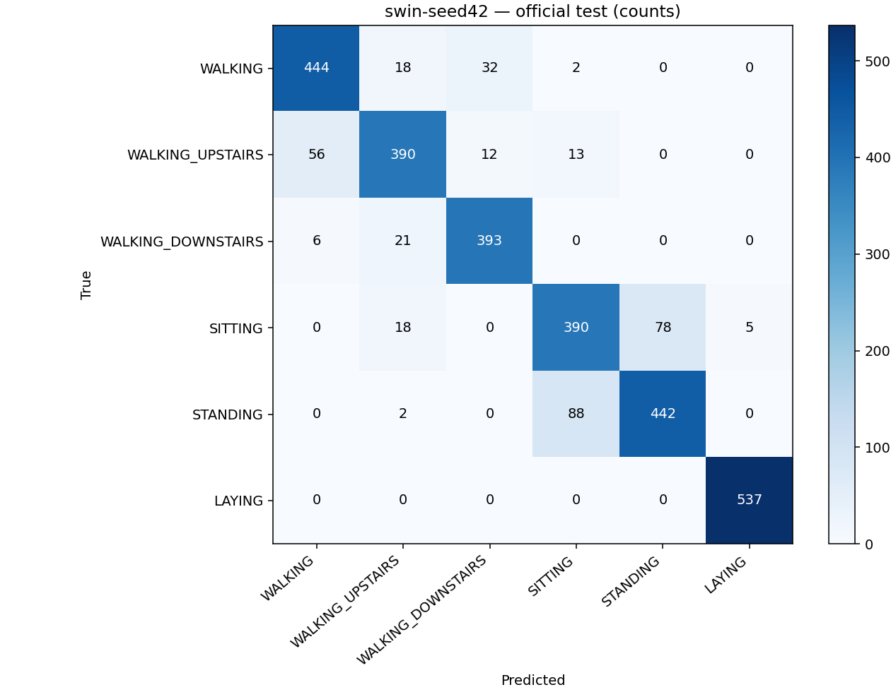

# Phase 3 — Huấn luyện và đánh giá UCI HAR

Cập nhật 03/10/2026: **Phase 3 trên Kaggle GPU đã hoàn tất và kiểm chứng artifact tải về**, ba seed mỗi family. Xem [báo cáo Kaggle hiện hành](kaggle-training-report.md): Swin seed 44 được chọn bằng validation, test macro-F1 0,870489; mục tiêu 0,90 vẫn chưa đạt, tiếp tục demo nghiên cứu có giới hạn.

Phần dưới là báo cáo lịch sử lượt **CPU cục bộ ngày 02/10/2026**, seed 42, CNN baseline và Swin Transformer 1D từ repo; không phải kết quả Kaggle. Không dùng toy data, không gắn nhãn giả, không thay source Swin. Những ghi chú Kaggle chưa xác nhận bên dưới mô tả trạng thái ở thời điểm lượt CPU.

## Kết quả test chính thức

5392 train / 1960 validation / 2947 test, subject-disjoint theo Phase 2. Chỉ total acceleration x/y/z, g, gồm gravity, 128 điểm tại 50 Hz. X trong NPZ đã chuẩn hóa bằng mean/std train-only.

| Model | Best epoch | Val macro-F1 | Test accuracy | Test macro-F1 | Epochs đã chạy | Thời gian train CPU |
|---|---:|---:|---:|---:|---:|---:|
| CNN baseline | 16 | 0,936112 | 0,919579 | 0,920024 | 28 | 53,12 giây |
| Swin 1D small | 12 | 0,912416 | 0,880896 | 0,879927 | 24 | 489,45 giây |

Thời gian là lần train ban đầu, không gồm chuẩn bị dữ liệu/evaluation. Máy: Ryzen 7 H 255, RAM khoảng 15,3 GiB; Python 3.11.9, torch 2.5.1+cpu, numpy 1.26.4, 4 PyTorch threads, không CUDA. Chỉ **một seed mỗi model**, chưa có trung bình/độ lệch chuẩn đa seed. GPU hoặc environment khác có thể ra số khác.

| Lớp Swin | Số test | Recall | F1 |
|---|---:|---:|---:|
| WALKING | 496 | 0,895161 | 0,886228 |
| WALKING_UPSTAIRS | 471 | 0,828025 | 0,847826 |
| WALKING_DOWNSTAIRS | 420 | 0,935714 | 0,917153 |
| SITTING | 491 | 0,794297 | 0,792683 |
| STANDING | 532 | 0,830827 | 0,840304 |
| LAYING | 537 | 1,000000 | 0,995366 |



Metric đầy đủ, per-class precision/recall/F1, loss và confusion matrix số đếm: `artifacts/phase3/evaluation/*-metrics.json`. Log/loss/validation từng epoch: `artifacts/phase3/runs/*/history.json`. Hình learning curves và CNN confusion matrix cùng thư mục evaluation. Trục hàng = nhãn thật, cột = dự đoán. Không nhầm confusion matrix count với xác suất.

## Phân tích và quyết định khi chưa đạt mục tiêu

Swin **chưa đạt macro-F1 ≥0,90**: 0,879927, thiếu khoảng 2,01 điểm phần trăm. Validation cao hơn test khoảng 3,25 điểm phần trăm. CNN tốt hơn Swin khoảng 4,01 điểm phần trăm test macro-F1 trong thí nghiệm này; không tuyên bố Swin tốt hơn baseline.

Có 351/2947 cửa sổ Swin dự đoán sai. 78 mẫu ngồi → đứng và 88 mẫu đứng → ngồi: 166/351, khoảng 47,3% tổng lỗi. Lên cầu thang → đi bộ: 56 mẫu; đi bộ → xuống cầu thang: 32 mẫu. Sự nhập nhằng giữa tư thế tĩnh và khác biệt subject là giả thuyết phù hợp để nghiên cứu, **không phải nguyên nhân đã được chứng minh chỉ từ confusion matrix**. Ba kênh total acceleration không chứa gyro/body acceleration của bản 9 kênh; không so trực tiếp metric này với benchmark dùng 9 kênh/561 features hoặc random window split.

Quyết định cho phiên bản hiện tại: **giữ Swin theo yêu cầu và tiếp tục Phase 4 theo hướng demo nghiên cứu**, với metric/giới hạn hiển thị rõ; không quảng cáo nhận dạng chính xác bảo đảm hoặc ứng dụng y tế/an toàn. Chưa phát hành web production. Không retrain/tune lại bằng test đã xem để tìm điểm ≥0,90. Muốn cải tiến sau này: chốt thí nghiệm trước, dùng subject-wise cross-validation chỉ trên original train để chọn regularization/learning rate/seed, rồi dùng một bộ đánh giá độc lập mới; test này đã được mở nên không còn là benchmark mù cho vòng tune tiếp theo. Không tự đổi phạm vi sang 9 kênh hoặc chuyển model deploy sang CNN.

## Cấu hình và tính tái lập

- Swin: patch 2, window 8, embed 32, depths [2,2,2,2], heads [2,4,8,16]; dropout/drop-path 0,1. 2.191.594 parameters. Giữ initialization gốc của mô hình; **không** áp dụng thay đổi norm weights dùng riêng trong fixture Phase 1.
- CNN: Conv1D 32/64/128, kernel 5 + BatchNorm + ReLU + MaxPool, global average pool và linear 6 lớp; dropout 0,1. 53.126 parameters. Chỉ dùng đối chứng.
- Cross-entropy, AdamW; CNN lr 0,001 / weight decay 0,01; Swin lr 0,0003 / weight decay 0,02. Batch 64, tối đa 60 epoch, warmup 3 + cosine, clipping 1, patience 12.
- Seed 42 cho Python/NumPy/PyTorch, deterministic algorithms, epoch-specific shuffle. Checkpoint chọn theo validation macro-F1, không theo test/loss train; early stopping theo cùng metric.
- `train_har.py` chỉ mở train và val. `evaluate_har.py` xác nhận dataset/checkpoint hash, ghi `selection.json` **trước** khi mở test; lựa chọn đã đóng băng không cho thay candidates sau đó. Có thể chạy lại cùng selection để kiểm tra tái lập, không dùng kết quả chạy lại để chọn model.
- `best.pth`: model state/config/seed/epoch, val metric, labels và preprocessing thật, trained=true. `last.pth`: thêm optimizer/scheduler/history/RNG cho resume cuối epoch. Checkpoint dùng pickle chỉ được load nếu do mình tạo/tin cậy.

## Chạy lại cục bộ

Dùng môi trường Python riêng; requirements training không cài video/3D/fusion. Máy này đã có `.venv-phase1`; nếu chưa có, tạo venv Python 3.11 rồi cài `training/requirements-training.txt` (CPU: cài torch wheel từ PyTorch CPU index trước để tránh CUDA tải nặng).

```powershell
$env:CUBLAS_WORKSPACE_CONFIG=':4096:8'
.venv-phase1/Scripts/python.exe training/prepare_uci_har.py --download
.venv-phase1/Scripts/python.exe training/verify_phase2.py
.venv-phase1/Scripts/python.exe training/train_har.py --config training/configs/train-cnn.json --output-dir artifacts/phase3/runs/cnn-seed42 --device cpu --resume
.venv-phase1/Scripts/python.exe training/train_har.py --config training/configs/train-swin.json --output-dir artifacts/phase3/runs/swin-seed42 --device cpu --resume
.venv-phase1/Scripts/python.exe training/evaluate_har.py --runs artifacts/phase3/runs/cnn-seed42 artifacts/phase3/runs/swin-seed42
.venv-phase1/Scripts/python.exe -m unittest discover -s training/tests -v
```

Bỏ `--resume` ở lần đầu nếu chưa có last.pth. Nếu config/data thay đổi, dùng thư mục thí nghiệm mới; không sửa run đã đóng băng. Cùng seed không bảo đảm bitwise giống nhau giữa OS/device/phiên bản thư viện khác.

## Notebook và nghiệm thu

Notebook: `notebooks/kaggle_train_har.ipynb`, hướng dẫn `notebooks/README.md`; tạo lại từ source bằng `training/build_kaggle_notebook.py`. Verifier đã chạy **7/7 code cells trong kernel Jupyter CPU**, dùng resume checkpoint hoàn tất, tái chuẩn bị/kiểm chứng dữ liệu, metric khớp CLI hoàn toàn và tạo ZIP. Bằng chứng nằm trong `artifacts/phase3/notebook-verification.json`. Đây không phải một lượt train lại từ đầu trong kernel và không phải kiểm chứng Kaggle GPU. Không yêu cầu API/backend trả phí. GPU Kaggle phụ thuộc quyền/quota của tài khoản, xem [tài liệu Kaggle](https://www.kaggle.com/docs/notebooks).

| Tiêu chí | Trạng thái |
|---|---|
| P3-01 | Notebook tự chứa source/config; chạy kiểm chứng kernel Jupyter CPU bằng verifier. GPU Kaggle cần user import/run để xác nhận, chưa nghiệm thu môi trường Kaggle |
| P3-02 | Đạt: CNN và Swin train thật, checkpoint chọn validation |
| P3-03 | Đạt: test metrics + per-class recall + confusion matrix |
| P3-04 | Mục tiêu 0,90 chưa đạt; có phân tích lỗi và quyết định demo nghiên cứu rõ giới hạn |
| P3-05 | Train/chọn model không dùng test; báo rõ một seed, chưa xác nhận quota Kaggle để chạy thêm seed |

9 unit tests pass: metric biết trước/invalid labels, forward/backward cả model, subject leakage, train không có test file, resume config mismatch, resume sau gián đoạn trọng số khớp chính xác, selection đóng băng. Phase 2 có 4 tests trong tổng 9. Chạy source compile và notebook code-cell compile đều pass. Web production build và 3 browser regression tests Phase 1 pass; không thay mô hình browser bằng checkpoint Phase 3. Tổng hợp: `artifacts/phase3/verification.json`.

## Đầu vào Phase 4

Checkpoint triển khai **cục bộ**: `artifacts/phase3/runs/swin-seed42/best.pth`, 8.815.954 bytes; SHA-256 `c17e391eb61639af322ac7e61fa936affe256094c3fdfaec5c36de652f81ac6a`. Checkpoint lớn và predictions không commit Git; logs/config/metric/hình được lưu để truy vết. Người clone repo phải train lại hoặc nhập artifact từ notebook, không tự nhận có checkpoint.

Phase 4 cần rebuild model đúng config, load strict state_dict, export ONNX không đổi weights đã học, kiểm tra parity/test F1 và benchmark browser. Sau đó mới thay artifact web `trained=false` của Phase 1 bằng release version/hash/labels/normalization/trained=true đồng bộ. Trang web hiện tại vẫn là smoke test **chưa nhận dạng bằng checkpoint này**.
